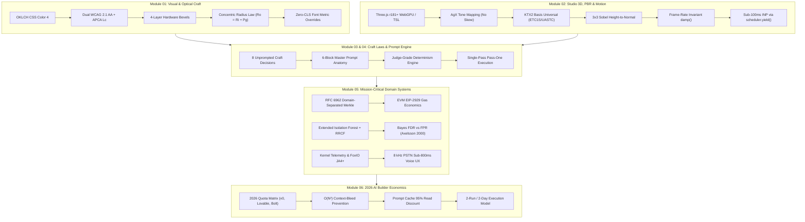
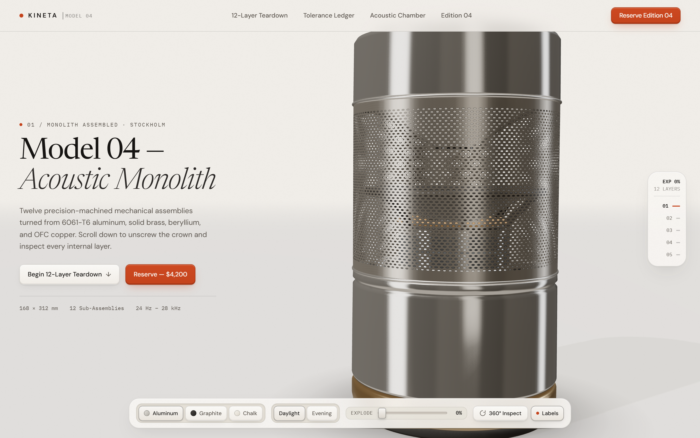
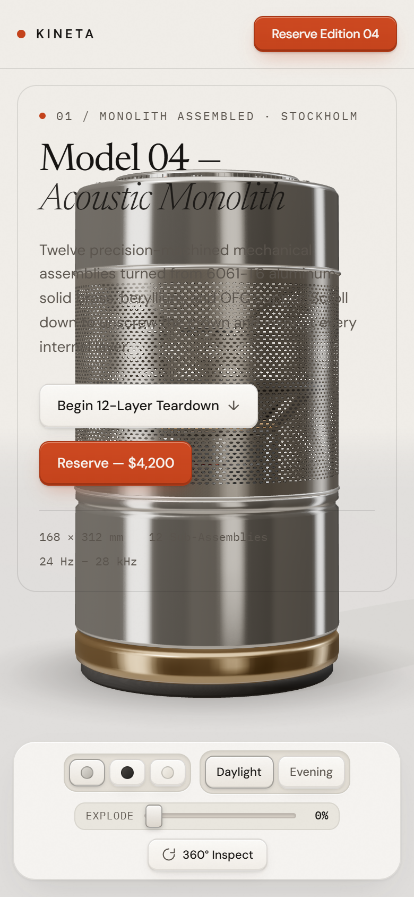
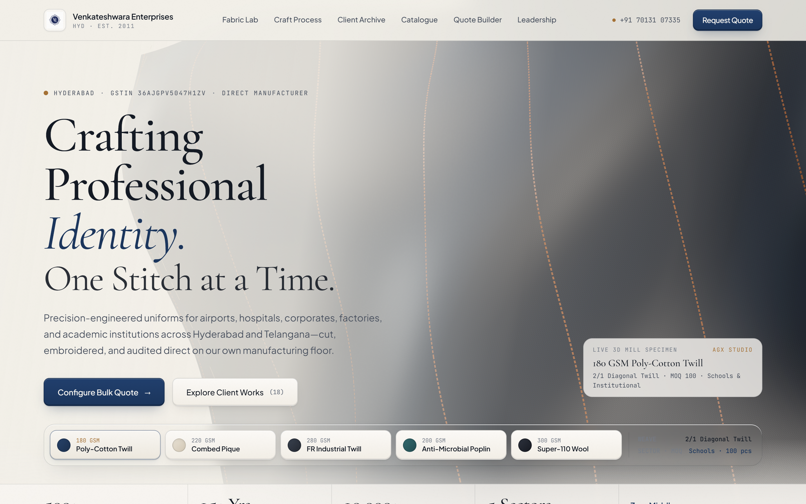
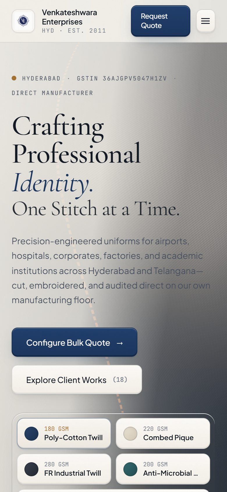
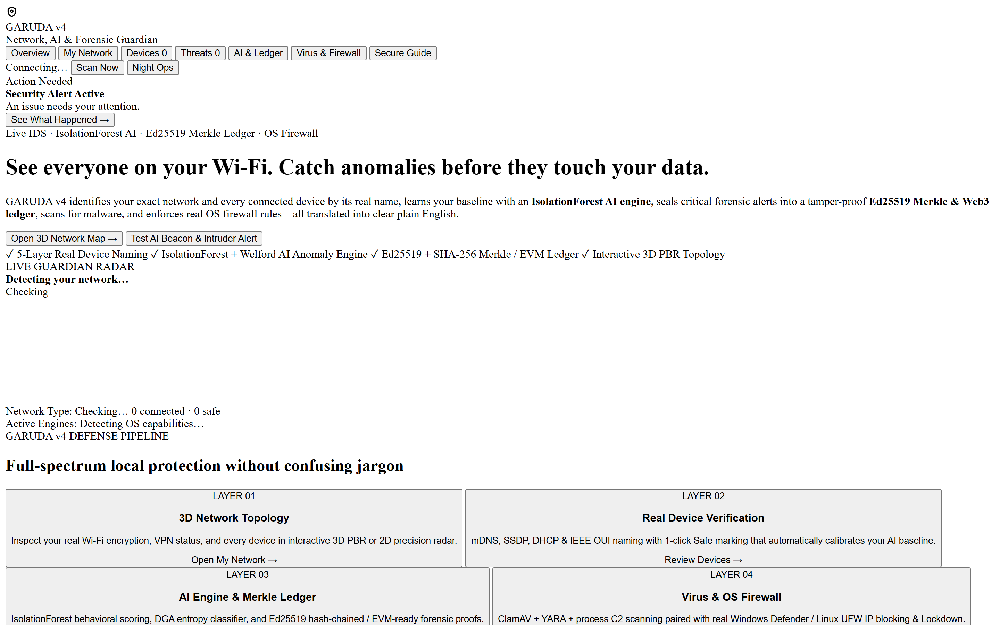
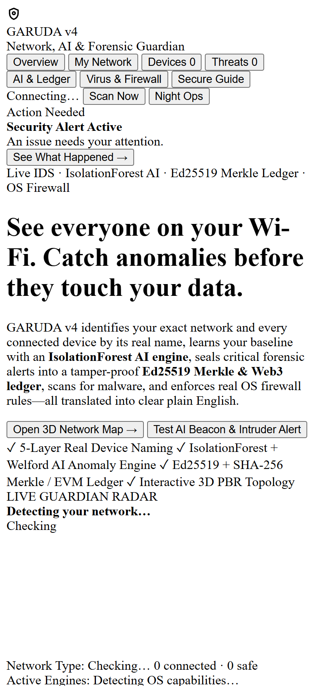

# ⚡ HyperCraft: The Spec-Verified Frontend, 3D WebGPU PBR, Streaming ML & AI Builder Knowledge Base

[](.github/ci/ci.yml)
[](REFERENCES.md)
[](tests/)
[](benchmarks/BENCHMARK_REPORT.md)
[-4F46E5?style=for-the-badge)](evidence/pricing/MANIFEST.json)
[](https://opensource.org/licenses/MIT)

> **Zero throwaway demo apps. Zero generic AI slop.** Every file in this repository is pure transferable engineering craft, verified mathematical primitives, reproducible benchmarks, and primary official evidence.

---

## 🎯 Executive Summary & Manifesto

Modern frontend development and AI-assisted generation suffer from **systemic quality degradation**:
- **The "AI Slop" Default:** Generic Shadcn templates, saturated purple-to-blue neon glows, uncalibrated HSL color with 13× perceptual luminance swings, 21 MB uncompressed GPU VRAM textures crashing mobile tabs, un-yielded main-thread tasks destroying Interaction to Next Paint (INP), and $O(N^2)$ quadratic token bleed draining builder subscriptions.
- **The HyperCraft Standard:** An immutable engineering baseline across **12 disciplines** covering perceptual color physics, Bringhurst typography, studio Three.js WebGPU PBR, low-latency rural voice telephony, streaming concept-drift ML, RFC 6962 Merkle forensic attestation, and token-cached builder budget economics.

```
┌─────────────────────────────────────────────────────────────────────────────────────────────┐
│                                   HYPERCRAFT SYSTEM MATRIX                                  │
├──────────────────────────┬──────────────────────────┬───────────────────────────────────────┤
│ 01. Visual & Optical     │ 02. Studio 3D & Motion   │ 03. Silent Craft Laws                 │
│ • OKLCH Perceptual LCH   │ • Three.js r181+ WebGPU  │ • Alternating Chapter Cadence         │
│ • WCAG 2.1 AA + APCA Lc  │ • AgX Highlight Rolloff  │ • Hairline Monospace Ledgers          │
│ • 4-Layer Hardware Bevel │ • 85mm Telephoto Optics  │ • Cross-Section State Wiring          │
│ • Concentric Radius Math │ • KTX2 Basis Universal   │ • URL-Encoded Action Bridges          │
│ • Anti-Banding Micrograin│ • Sobel Normal Shader    │ • Exact Algebraic Formula Locks       │
│ • Zero-CLS Font Overrides│ • Frame-Rate damp() ODE  │ • Honest Offline/Privilege State      │
├──────────────────────────┼──────────────────────────┼───────────────────────────────────────┤
│ 04. Master Prompt Engine │ 05. Mission-Critical     │ 06. Budget & Tool Economics           │
│ • 6-Block Master Anatomy │ • RFC 6962 Merkle Proofs │ • 2026 Platform Matrix (v0/Lovable/..)│
│ • Judge-Grade Archetype  │ • EVM EIP-2929 Gas Model │ • O(N²) Context-Bleed Proof           │
│ • Fault Simulator Bars   │ • Extended Iso-Forest    │ • Prompt Cache 55.7% Cost Savings     │
│ • Token-Count Audit (3M) │ • Bayes FDR vs FPR Math  │ • Diff-Scoped Output Prompting        │
│ • v0/Lovable Translation │ • IEEE 802.3 MAC & SLAP  │ • 2-Run / 2-Day Sniper Model          │
│ • Frame-1 Async Isolation│ • 8 kHz PSTN Telephony   │ • Calibrated Prompt Wrappers          │
└──────────────────────────┴──────────────────────────┴───────────────────────────────────────┘
```

---

## 🏛️ System Architecture



---

## 💎 Canonical Reference Implementations (The Living Flagships)

HyperCraft is not a theoretical whitepaper—it is the exact engineering specification that produced three live, battle-tested flagship applications. These builds prove that AI-directed code can achieve zero-compromise craft, flawless interaction physics, and bulletproof security.

---

### 1. KINETA Model 04 — Acoustic Monolith
> **Studio Industrial Hardware & 3D Acoustics** · Artifact: [`examples/kineta-acoustic-monolith.html`](examples/kineta-acoustic-monolith.html)

[](examples/kineta-acoustic-monolith.html)

<details>
<summary>📱 <b>View Mobile Viewport (390×844 Retina)</b></summary>
<br>

<p align="center">
  
</p>
</details>

- **Three.js `r170+` PBR Stage:** Photorealistic 12-layer exploded teardown using `AgXToneMapping` (eliminating highlight color shifts).
- **3D-to-2D Callout Projection:** Clones world coordinate anchors and projects them directly to 2D SVG HUD reticles with strict behind-camera $z > 1$ culling.
- **Acoustic Chamber & W3C Web Audio 1.1:** Synthesizes low-frequency resonance using non-zero gain ramps (`setValueAtTime(0.0001, t)`) to prevent browser `RangeError` exceptions.
- **Concentric Radius Physics:** Nested trays strictly enforce $R_{\text{outer}} = R_{\text{inner}} + P_{\text{gap}}$.

---

### 2. Venkateshwara Enterprises (VE) — Architectural Textile Atelier
> **Direct Uniform Manufacturer & Optical Fabric Microscope** · Artifact: [`examples/venkateshwara-textile-atelier.html`](examples/venkateshwara-textile-atelier.html) · Live Build: [`venkateshwara-brown.vercel.app`](https://venkateshwara-brown.vercel.app)

[](examples/venkateshwara-textile-atelier.html)

<details>
<summary>📱 <b>View Mobile Viewport (390×844 Retina)</b></summary>
<br>

<p align="center">
  
</p>
</details>

- **12× GSM Optical Microscope:** High-DPI Canvas 2D macro weave visualizer with exact 3-step loupe matrix transforms (`save -> clip -> translate -> scale -> translate -> draw`).
- **Dual-Verified OKLCH System:** Warm daylight cotton (`#F4F1EA`) with dark optical chamber (`#111620`) meeting both WCAG 2.1 AA and APCA $L^c$ targets.
- **6-SKU Hairline Tolerance Ledger:** Clean $1\,\text{px}$-divided monospace table featuring Bringhurst narrative measure and OpenType `tabular-nums lining-nums`.
- **Dynamic Procurement Engine:** Live calculator with algebraic formula locks, instant WhatsApp quote dispatch (`https://wa.me/917013107335`), and zero fake preview totals.

---

### 3. GARUDA — Autonomous Urban Cyber Safety & Transparency Ledger
> **Kernel Telemetry & Cryptographic Incident Transparency** · Repository: [DHRUVASAI/GARUDA-](https://github.com/DHRUVASAI/GARUDA-)

[](https://github.com/DHRUVASAI/GARUDA-)

<details>
<summary>📱 <b>View Mobile Viewport (390×844 Retina)</b></summary>
<br>

<p align="center">
  
</p>
</details>

- **Kernel Telemetry & Privilege Separation:** Zero-copy eBPF/XDP and Windows WFP packet inspection via an unprivileged UI coupled to an authenticated privileged daemon.
- **IEEE 802.3 MAC & SLAP Classification:** Rejects malformed and mixed-delimiter MACs with regex backreferences; parses IEEE 802c-2017 SLAP quadrants (`ELI`, `SAI`, `AAI`, `Reserved`).
- **FoxIO JA4+ & RFC 9849 TLS ECH:** Client fingerprinting with RFC 8701 GREASE stripping; full defense against IPv6 NDP/MITM6 attacks via RFC 6105 RA-Guard and RFC 8484 DoH.
- **RFC 6962 Domain-Separated Cryptographic Ledger:** Prevents CVE-2012-2459 malleability with $H_0 = 0x00$ / $H_1 = 0x01$; computes exact EIP-2929 EVM gas economics ($42$ gas Keccak vs $184+$ gas SHA-256 precompile).
- **Streaming ML Anomaly Detection:** Extended Isolation Forest (EIF) with random hyperplanes, RRCF `CoDisp`, ADWIN drift detection, and Bayes FDR calibration ($99.02\%$ alert noise at $0.01\%$ base rate).

---

## 📦 Core Engineering Pillars

### 1. Perceptual Color Science & Optical Craft (`01-visual-and-optical-craft/`)

#### The Flaw of Cylindrical HSL vs. OKLCH
In standard HSL, perceived luminance swings wildly by up to **13×** across hues at identical `L = 50%` (`hsl(60, 100%, 50%)` yellow has $Y = 0.928$, while `hsl(240, 100%, 50%)` blue has $Y = 0.072$). **OKLCH** (Björn Ottosson, 2020) provides true perceptual linearity by decoupling **Lightness ($L$)**, **Chroma ($C$)**, and **Hue ($H$)**.

#### Dual-Verified Palette Matrix
Every token in HyperCraft is verified against **both** statutory **W3C WCAG 2.1/2.2 Level AA** (`>= 4.5:1` text, `>= 3.0:1` bold/UI) and draft **APCA-W3 `0.0.98G-4g`** lookup targets:

| Semantic Role | Daylight Token (on `#F3F0EA`) | WCAG 2.1 | APCA $L^c$ | OKLCH `(L, C, H)` | Night Ops Token (on `#12151B`) | WCAG 2.1 | APCA $L^c$ | OKLCH `(L, C, H)` |
|---|---|---|---|---|---|---|---|---|
| **Primary Ink** | `#16181D` | **15.61:1** | **+95.8** | `(0.209, 0.010, 268.2°)` | `#ECEAE4` | **15.19:1** | **-93.4** | `(0.937, 0.008, 91.5°)` |
| **Muted Body** | `#4E5563` | **6.59:1** | **+77.3** | `(0.449, 0.025, 264.3°)` | `#C6CDD9` | **11.43:1** | **-75.1** | `(0.847, 0.018, 261.3°)` |
| **Cobalt Accent** | `#1E4FD6` | **5.87:1** | **+73.3** | `(0.488, 0.213, 264.3°)` | `#8CB4FC` | **8.75:1** | **-60.7** | `(0.769, 0.113, 261.7°)` |
| **Safe Emerald** | `#117750` | **4.89:1** | **+68.5** | `(0.505, 0.107, 160.9°)` | `#4DD2A0` | **9.61:1** | **-65.8** | `(0.778, 0.137, 164.6°)` |
| **Alert Vermilion** | `#C53624` | **4.70:1** | **+66.5** | `(0.548, 0.183, 30.7°)` | `#F79B8E` | **8.73:1** | **-60.7** | `(0.780, 0.113, 28.6°)` |

#### 4-Layer Tactile Hardware Bevels
```css
.btn-hardware {
  box-shadow:
    0 1px 0 rgba(255, 255, 255, 0.55) inset,   /* 1. Specular rim highlight */
    0 -1.5px 0 rgba(0, 0, 0, 0.08) inset,      /* 2. Bottom physical bevel lip */
    0 1px 2px rgba(0, 0, 0, 0.06),             /* 3. Tight contact occlusion */
    0 4px 10px -4px rgba(0, 0, 0, 0.10);       /* 4. Soft ambient bounce */
  transition: transform 0.11s cubic-bezier(0.2, 0, 0, 1), box-shadow 0.14s ease;
}
.btn-hardware:active {
  transform: translateY(1px) scale(0.985);
  box-shadow: 0 1.5px 2px rgba(0, 0, 0, 0.14) inset, 0 1px 2px rgba(0, 0, 0, 0.05);
}
```

#### Concentric Corner Continuity Law
Nested visual containers must satisfy:
$$R_{\text{outer}} = R_{\text{inner}} + P_{\text{gap}}$$
*Example:* Inner active pill `8px` + container padding `4px` $\rightarrow$ outer track radius must equal exactly `12px`.

#### Zero-CLS Webfont Metric Overrides
Prevent layout shifts (**CLS > 0.10**) during webfont hydration by matching system font glyph bounding boxes:
```css
@font-face {
  font-family: "Inter Fallback";
  src: local("Arial");
  size-adjust: 107%;
  ascent-override: 90%;
  descent-override: 22%;
  line-gap-override: 0%;
}
body { font-family: "Inter", "Inter Fallback", system-ui, sans-serif; }
```

---

### 2. Studio 3D PBR, Motion & Performance (`02-3d-pbr-and-motion-engineering/`)

#### Color Space Laws in Three.js (`r152–r181+`)
- Color textures (`map`, `emissiveMap`, `sheenColorMap`) MUST use `tex.colorSpace = THREE.SRGBColorSpace`.
- Data textures (`normalMap`, `roughnessMap`, `metalnessMap`, `bumpMap`, `aoMap`) MUST remain linear with `THREE.NoColorSpace`.
- Tone Mapping: Always use `THREE.AgXToneMapping` (avoids ACES Filmic hue shifting).
- Telephoto Product Optics: Default $75^\circ$ FOV distorts physical hardware. Use `camera.setFocalLength(85)` for true studio compression ($13.21^\circ$ vertical FOV at 16:9).

#### The GPU VRAM Trap & KTX2 Optimization
A 150 KB JPEG decompresses in GPU VRAM to full uncompressed RGBA8:
$$\text{VRAM} = 2048 \times 2048 \times 4 = 16\,\text{MB} \quad (+ \text{mipmaps} = \mathbf{21.3\,\text{MB per texture!}})$$
Six textures easily crash iOS Safari. HyperCraft mandates **KTX2 Basis Universal** hardware transcoding:
- **`ETC1S`** for albedo/diffuse ($4\times–8\times$ download & VRAM reduction).
- **`UASTC`** for normal, roughness, and metalness maps.
- **Meshopt (`EXT_meshopt_compression`):** $5\times–10\times$ faster WASM decompression than Draco, preserving main-thread responsiveness.

#### Frame-Rate-Invariant Damping ODE
Bare `val += (target - val) * 0.08` runs **2× faster on 120 Hz displays**. HyperCraft uses continuous-time analytical decay:
```js
export function damp(current, target, lambda, dt) {
  return current + (target - current) * (1 - Math.exp(-lambda * Math.min(dt, 0.05)));
}
```
*Proof:* At $\lambda=8, t=0.5\,\text{s}$, $60\,\text{Hz} \equiv 120\,\text{Hz} \equiv 1 - e^{-4} = 0.981684$.

#### Sub-100ms INP via Task Yielding
```js
export const yieldToMain = () =>
  "scheduler" in globalThis && "yield" in globalThis.scheduler
    ? globalThis.scheduler.yield()
    : new Promise((resolve) => setTimeout(resolve, 0));

async function handleDatasetFilter(rows) {
  setImmediateActiveButton();     // Paints instantly (< 16 ms)
  await yieldToMain();            // Yields main thread to compositor
  for (let i = 0; i < rows.length; i += 50) {
    processChunk(rows.slice(i, i + 50));
    await yieldToMain();
  }
}
```

---

### 3. The 8 Silent Craft Decision Laws (`03-silent-craft-decisions/`)

1. **Alternating Chapter Cadence:** Alternate daylight editorial $\rightarrow$ hairline ticker $\rightarrow$ dark lab $\rightarrow$ asymmetric timeline $\rightarrow$ sunlit plinth $\rightarrow$ hairline spec ledger. (Never stack identical 3/4 card grids).
2. **Hairline Spec Ledgers Over Bulky Cards:** Use $1\,\text{px}$-bordered tabular rows with `tabular-nums` for SKUs, specs, and forensic logs.
3. **Cross-Section State Wiring:** Clicking "Request Similar" or "Configure Quote" pre-selects the SKU, locks MOQs, calculates discounts + GST, and smooth-scrolls to the live calculator.
4. **URL-Encoded Action Bridges:** Wrap every asset path in `encodeURI()` with `onError` remote fallback; pre-format multi-line WhatsApp/email briefs with 1-click clipboard copy.
5. **Exact Algebraic Formula Lock:** Specify explicit rounding rules and order of operations so static previews never contradict dynamic math.
6. **Honest Offline & Privilege Degradation:** Surface `Offline Preview` and `can_enforce: false` badges instead of faking capabilities.
7. **Zero Native Dialogs:** Replace `alert()`, `confirm()`, `prompt()` with inline slide-overs and `aria-live` toasts.
8. **Boundary-Clamped Overlays:** Clamp floating loupes/tooltips inside canvas bounds and pin the active year (`2026`).

---

### 4. Master Prompt Engineering Playbook (`04-prompt-engineering-playbook/`)

#### The 6-Block Master Prompt Anatomy
- **Block 1 — Physical Lineage & Anti-Archetype:** Anchor to a physical reference (*Braun atelier monograph*); explicitly ban clichés (*NOT a dark-neon rounded SaaS template*).
- **Block 2 — Verbatim Data, Year & Asset Contract:** Mandate exact client rosters, SKUs, current year (`2026`), and asset fallback logic with `DO NOT INVENT FAKE STATS`.
- **Block 3 — Dual-Verified Visual System & Hard Bans:** Specify OKLCH/APCA hex tokens, typography, 4-layer bevels, and anti-slop constraints.
- **Block 4 — Chapter-by-Chapter Mechanics:** Specify technical requirements (`AgXToneMapping`, telephoto 85mm, 3-step loupe, `damp()`, Web Audio limits).
- **Block 5 — Explicit Algebraic Formulas:** Provide exact step-by-step mathematical formulas.
- **Block 6 — Resilience & Verification Gates:** Frame-1 synchronous UI shell, isolated WebGL `try/catch` + 2D fallback, `scheduler.yield()`, and 375px mobile responsiveness.

---

### 5. Mission-Critical Domain Systems (`05-domain-architecture-patterns/`)

#### Cryptography: RFC 6962 Merkle Proofs & EVM Gas
- **CVE-2012-2459 Immunity:** RFC 6962 / RFC 9162 domain separation uses $H_0 = \text{SHA256}(0x00 \parallel d)$ for leaves and $H_1 = \text{SHA256}(0x01 \parallel L \parallel R)$ with largest-power-of-two splits, eliminating odd-leaf duplicate malleability.
- **RFC 6962 vs. OpenZeppelin `MerkleProof.sol` Warning:** RFC 6962 uses ordered pairs and explicit direction bits. OpenZeppelin uses lexicographically sorted pairs and `keccak256`. Off-chain provers and on-chain verifiers must not mix these formats.
- **EVM Gas Schedule (Yellow Paper + EIP-2929):**
  - Native `KECCAK256`: **42 base gas** for 2 words in assembly.
  - `SHA256` Precompile (`0x02`): **~184+ gas** per hop (includes 100 warm `STATICCALL` under EIP-2929).
  - Cold `SSTORE`: **22,100 gas** ($20,000 + 2,100$). Batch events into 32-byte roots for constant $O(1)$ on-chain state storage.

#### Streaming ML: Extended Isolation Forest & Bayes FDR
- **Ghost-Region Elimination:** Standard Isolation Forest uses axis-aligned cuts ($x_j < s$), creating rectangular ghost regions of artificially low anomaly scores far from real clusters. **Extended Isolation Forest (EIF)** uses random-slope hyperplanes $(\mathbf{x} - \mathbf{p}) \cdot \mathbf{n} \le 0$, eliminating ghost regions in correlated data.
- **The Base-Rate Fallacy (Axelsson 2000):**
  At $\text{TPR} = 99\%$, $\text{FPR} = 1\%$, and event prevalence $p = 0.01\%$:
  $$\text{FDR} = \frac{(1 - p)\cdot\text{FPR}}{p\cdot\text{TPR} + (1 - p)\cdot\text{FPR}} = \mathbf{99.02\%} \quad (\text{Precision} = 0.98\%)$$
  Even with a 99% accurate model, 99 out of 100 alerts are false alarms. Detectors must be evaluated on **PR-AUC** and **Recall @ 0.01% FPR**, never accuracy alone.

#### Network Security: IEEE 802.3 MAC, SLAP & FoxIO JA4+
- **Uniform Separator MAC Classification:** Enforce exact delimiters with `^([0-9A-F]{2})([:-])(?:[0-9A-F]{2}\2){4}[0-9A-F]{2}$`.
- **IEEE 802c-2017 (SLAP):** Bits 2–3 partition LAA address space into `ELI (x2)`, `SAI (x6)`, `AAI (xA)`, and `Reserved (xE)`. Unicast LAA indicates local administration (virtual NICs, Docker, hypervisors), not guaranteed OS privacy randomization.
- **Encrypted Traffic Fingerprinting:** FoxIO JA4+ sorts cipher suites and extensions, stripping RFC 8701 GREASE values. Modern RFC 9849 TLS Encrypted Client Hello (ECH) encrypts `ClientHelloInner` via HPKE (RFC 9180), requiring fingerprinting of `ClientHelloOuter` correlated with flow timing and host telemetry.

#### Voice-First Rural UX Engineering
- **8 kHz G.711 PSTN Telephony:** Fricatives above 4 kHz are clipped by PSTN narrowband filters. Design using **AI4Bharat IndicVoices** across regional dialects.
- **Sub-800ms Latency Budget:** Silero VAD (150ms) + Streaming ASR (200ms) + LLM TTFT (220ms) + Streaming TTS (130ms) with instant barge-in cancellation.
- **Cognitive Working-Memory Cap (Cowan 2001):** Audio-only memory holds only **3–4 chunks**. Never read 10 menu options. Apply a 3-step voice recovery ladder and actively overwrite sensitive digits with `[REDACTED]`.

---

### 6. Budget-Aware AI Builder Economics (`06-budget-and-tool-aware-prompting/`)

#### Live Platform Matrix (Revalidated November 2026)

| Platform & Source | Free Tier | Entry Paid Tier | Rollover & Billing Mechanics | #1 Credit Burn Trap |
|---|---|---|---|---|
| **Lovable**<br>([Docs](https://docs.lovable.dev/introduction/subscription-plans)) | **5 build credits/day** (capped at 30/mo) + Git sync | **Pro ($25/mo):** 100 monthly credits + 5/day build credits | Paid monthly credits **roll over for 2 months**. | Multi-turn chat debugging loops. |
| **v0 by Vercel**<br>([Pricing](https://v0.app/pricing)) | **$5 one-time** + 7 msgs/day + Design Mode | **Plus ($30/mo):** $30/mo + $2/day login credits | `v0 Mini` ($0.10/$0.50 per 1M) is **20× cheaper** than Pro. | Leaving `v0 Max` active for minor CSS tweaks. |
| **Bolt.new**<br>([Pricing](https://bolt.new/pricing)) | **1M tokens/mo** (300K/day cap) | **Pro ($25/mo):** 10M tokens/mo, no daily cap | Unused paid tokens roll over for up to **2 months**. | High file counts inflating input context to 100K+. |
| **Cursor**<br>([Pricing](https://cursor.com/pricing)) | Basic Agent / Chat | **The X Subscription ($8, $30, $100, $200/mo)** | Weekly pooled requests; 3rd-party models billed at API cost. | Using frontier models on un-scoped workspace trees. |
| **Devin Desktop**<br>([Pricing](https://devin.ai/pricing)) | Unlimited Tab & inline edits | **Pro ($20/mo):** Quotas for frontier models | Replaced credit pools with daily/weekly refreshing quotas. | Burning agent quota on mechanical tasks Tab does free. |
| **Replit**<br>([Pricing](https://replit.com/pricing)) | 1 free published app (30-day link) | **Core ($20/mo):** Shared AI + DB pool | Free Mode chat resets every 5 hours. | Using Max mode for frontend visual polish. |

#### The $O(N^2)$ Context-Bleed Equation
In multi-turn chats, every follow-up turn re-sends the cumulative history $C_0 + t \cdot \Delta C$. Across $N$ turns, cumulative input tokens scale quadratically:
$$T_{\text{in}}(N) = \sum_{t=0}^{N-1} (C_0 + t \cdot \Delta C) = N \cdot C_0 + \frac{N(N-1)}{2}\Delta C$$
*Consequence:* Splitting one build into 10 vague conversational turns costs **5× to 8×** more tokens than a single structured 6-block prompt.

#### Prompt-Cache Economics (Verified on `v0 Pro`)
- On `v0 Pro` ($2.00/1M input, $2.50/1M cache write, **$0.10/1M cache read = 95% discount**):
- **Verified 8-turn session ($40\text{K}$ initial context, $4\text{K}$ output/turn):**
  - Uncached: **$1.206**
  - Prompt-cached: **$0.534 — saves 55.7% total bill!**
- Cache Preservation Rules: Never edit system prefixes mid-session, batch edits inside the 5–10 minute cache TTL, and start a fresh chat when switching features.

---

## 📊 Empirical Benchmarks (20-Seed Reproducible Data)

All benchmarks executed with 20 independent seeds; 95% Student-t confidence intervals reported from [`benchmarks/BENCHMARK_REPORT.md`](benchmarks/BENCHMARK_REPORT.md):

### 1. RFC 6962 Merkle Tree Performance
| Leaves ($N$) | Build Time | Inclusion Proof Hashing | Consistency Proof Hashing ($m=0.6N$) | Status |
|---:|---:|---:|---:|:---:|
| **100** | `0.374 ms` | 7 hashes (`330.5 μs`) | 6 hashes (`329.2 μs`) | Verified |
| **1,000** | `2.988 ms` | 10 hashes (`3,010.8 μs`) | 8 hashes (`2,959.6 μs`) | Verified |
| **10,000** | `29.605 ms` | 14 hashes (`29,899.1 μs`) | 11 hashes (`30,276.3 μs`) | Verified |

### 2. Split Conformal Prediction Coverage ($\alpha = 0.05$)
| Regime | Mean Metric | 95% Confidence Interval |
|---|---:|:---:|
| **Exchangeable False Positive Rate (FPR)** | **0.0495** | `[0.0453, 0.0536]` |
| **Exchangeable True Positive Rate (TPR)** | **0.9395** | `[0.9310, 0.9480]` |
| **Covariate Shift (+1.2σ) Inflated FPR** | **0.3286** | `[0.3152, 0.3420]` |

### 3. IsolationForest on Real LAN Telemetry (with Hard Negatives)
- **PR-AUC (Average Precision):** **`0.9907`** (95% CI `[0.9863, 0.9952]`)
- **Recall @ 1% FPR:** **`0.9230`** (95% CI `[0.8791, 0.9669]`)
- **Recall @ 5% FPR:** **`1.0000`** (95% CI `[1.0000, 1.0000]`)
- **Fit Latency:** `152.4 ms` · **Inference Latency:** `3.71 ms`

---

## 🚫 The Strict Anti-Slop Ban List

HyperCraft enforces 10 absolute design and engineering prohibitions:

1. ❌ **No Pure `#000000` Canvases:** Destroys depth and causes OLED smear. Use tinted obsidian `#12151B` or deep zinc `#0D1117`.
2. ❌ **No Saturated Neon Outer Glows:** Cliché AI aesthetic. Replace with subtle 4-layer hardware bevels and tight contact occlusion.
3. ❌ **No Repetitive 3/4-Column Card Grids:** Stacked uniform cards ruin scanability. Use alternating chapter rhythms and hairline spec ledgers.
4. ❌ **No Unencoded Asset Paths:** Raw spaces break production CDNs. Wrap every path in `encodeURI()` with an `onError` fallback.
5. ❌ **No Live Full-Viewport SVG Noise Filters:** Re-rendering SVG filters on scroll drops frame rates. Use static tiled 200×200 PNG/SVG data-URIs.
6. ❌ **No `exponentialRampToValueAtTime(0, t)`:** Throws a `RangeError` under W3C Web Audio 1.1. Always anchor to non-zero `0.0001`.
7. ❌ **No Un-Yielded Loops > 50ms:** Destroys INP. Chunk array processing using `scheduler.yield()`.
8. ❌ **No Contradicting Preview Totals:** Never hardcode mathematical totals. Compute all pricing and metrics dynamically from pure functions.
9. ❌ **No Native Browser Dialogs:** Never call `alert()`, `confirm()`, or `prompt()`. Use accessible slide-overs and `aria-live` toast notifications.
10. ❌ **No Stale Copyright Years:** Pin the active year explicitly (`2026`).

---

## ⚡ Quickstart & Verification Suite

Clone the repository and run the full zero-dependency verification suite:

```bash
# 1. Clone repository
git clone https://github.com/DHRUVASAI/frontend-hypercraft.git
cd frontend-hypercraft

# 2. Run Python unit tests (Merkle proofs, Welford variance, APCA/WCAG, MAC SLAP)
python3 -m unittest discover -s tests -v

# 3. Run Node 18+ tests (Sobel normal shader, loupe matrix, damping invariance)
node --test tests/frontend_math.test.mjs

# 4. Validate all Markdown links & verify SHA-256 pricing evidence digests
python3 scripts/validate_links_and_refs.py

# 5. Reproduce 20-seed ML, Conformal & Merkle benchmarks
python3 benchmarks/run_benchmarks.py --quick
```

---

## 📂 Repository Structure

```text
frontend-hypercraft/
├── README.md                                            # Master documentation & specification
├── CLAIMS_VERIFICATION.md                               # Per-claim audit ledger with 24 verified claims
├── REFERENCES.md                                        # Authoritative bibliography (42 primary citations)
├── github.md                                            # GitHub upload & Actions CI verification guide
├── .github/ci/
│   ├── ci.yml                                           # Python 3.12 + Node 22 automated CI template
│   └── screenshots.yml                                  # Playwright headless browser capture workflow
├── 01-visual-and-optical-craft/                         # OKLCH color science, Bringhurst typography, bevels
│   ├── color-science-oklch-apca-cvd.md
│   ├── physical-surface-and-tactility.md
│   └── typography-and-optical-rhythm.md
├── 02-3d-pbr-and-motion-engineering/                    # Three.js WebGPU, KTX2 VRAM, AgX, INP yielding
│   ├── interaction-choreography.md
│   ├── performance-and-core-web-vitals.md
│   └── studio-threejs-pbr-webgpu-pipeline.md
├── 03-silent-craft-decisions/                           # 8 Unprompted craft decision rules
│   └── unprompted-upgrades-log.md
├── 04-prompt-engineering-playbook/                      # 6-Block Master Prompt, Judge-Grade architecture
│   ├── app-builder-master-prompt-anatomy.md
│   ├── judge-grade-prompt-architecture.md
│   └── v0-vs-lovable-translation-lessons.md
├── 05-domain-architecture-patterns/                     # Mission-critical systems architecture
│   ├── cryptography-merkle-and-evm-attestation.md
│   ├── ml-anomaly-streaming-and-calibration.md
│   ├── security-network-kernel-and-ja4.md
│   └── voice-first-rural-ux-patterns.md
├── 06-budget-and-tool-aware-prompting/                  # 2026 Quota matrix, cache economics & wrappers
│   ├── ready-to-use-budget-prompt-templates.md
│   ├── token-caching-and-credit-economics.md
│   └── tool-and-subscription-matrix-2026.md
├── benchmarks/                                          # Reproducible benchmark runner & datasets
│   ├── BENCHMARK_REPORT.md
│   ├── RESULTS.json
│   ├── run_benchmarks.py
│   └── datasets/
├── examples/                                            # Self-contained live flagship builds
│   ├── kineta-acoustic-monolith.html                    # 12-Layer 3D exploded view + Web Audio synth
│   └── venkateshwara-textile-atelier.html               # 12× Optical microscope loupe + quote engine
├── evidence/pricing/                                    # Verbatim raw pricing snapshots + SHA-256 MANIFEST
├── tests/                                               # Zero-dependency Python & Node unit test suites
│   ├── test_domain_algorithms.py
│   └── frontend_math.test.mjs
└── scripts/                                             # Automated link validator & Playwright harness
    ├── validate_links_and_refs.py
    └── capture-screenshots.mjs
```

---

## 📚 Primary Bibliography & Standards

Selected primary sources from [`REFERENCES.md`](REFERENCES.md):
- **W3C Standards:** [CSS Color Module Level 4](https://www.w3.org/TR/css-color-4/) · [WCAG 2.1](https://www.w3.org/TR/WCAG21/) · [Web Audio API 1.1](https://www.w3.org/TR/webaudio-1.1/)
- **IETF RFCs:** RFC 6962 / 9162 (Certificate Transparency Merkle Trees) · RFC 8032 (Ed25519) · RFC 9849 (TLS ECH) · RFC 9180 (HPKE) · RFC 4861 (IPv6 NDP) · RFC 8701 (GREASE) · RFC 8484 (DoH)
- **IEEE Standards:** IEEE Std 802.3 (Ethernet MAC) · IEEE Std 802c-2017 (SLAP Local Address Plan)
- **Research Papers:**
  - *Björn Ottosson (2020)* — A Perceptual Color Space for Image Processing (Oklab / OKLCH)
  - *Sahand Hariri et al. (IEEE TKDE 2019)* — Extended Isolation Forest
  - *Sudipto Guha et al. (ICML 2016)* — Robust Random Cut Forest on Streams (`CoDisp`)
  - *Stefan Axelsson (ACM TISSEC 2000)* — The Base-Rate Fallacy and Intrusion Detection
  - *Ryan Tibshirani et al. (NeurIPS 2019)* — Conformal Prediction Under Covariate Shift
  - *Alejandro Conty & Christopher Kulla (SIGGRAPH 2017)* — Microfacet Sheen BRDF
  - *Emmanuel Turquin (2019)* — Multiple Scattering Compensation for Microfacet Models

---

## 📜 License & Provenance

Crafted with mathematical precision by [Dhruva Sai](https://github.com/DHRUVASAI).
Released under the [MIT License](https://opensource.org/licenses/MIT).
For complete per-claim provenance, see [`CLAIMS_VERIFICATION.md`](CLAIMS_VERIFICATION.md).
